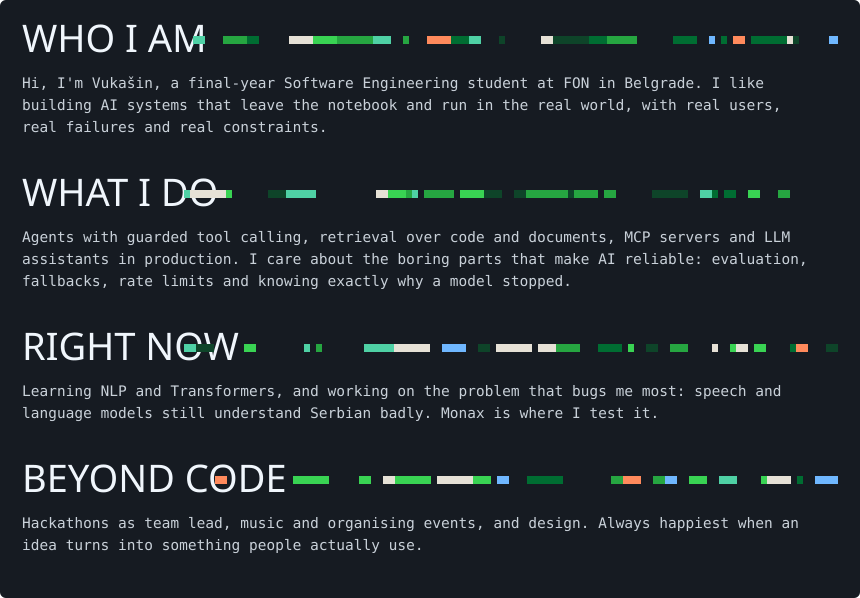
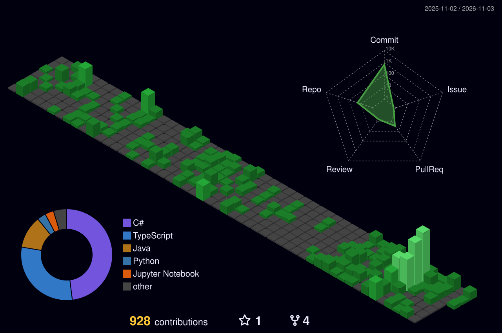

<table align="center">
  <tr>
    <td align="center" width="140"><b>LinkedIn</b></td>
    <td align="center" width="140"><b>Gmail</b></td>
    <td align="center" width="140"><b>Behance</b></td>
    <td align="center" width="140"><b>Srpski u Srcu</b></td>
  </tr>
  <tr>
    <td align="center"></td>
    <td align="center"></td>
    <td align="center"></td>
    <td align="center"></td>
  </tr>
</table>

<table>
  <tr>
    <td width="50%" valign="top">
      <h3>🛠️ <a href="https://github.com/VukasinLukic/VukixAI-agent.v1">VukixAI</a></h3>
      
Local coding agent in the terminal. My own <b>tool-calling loop</b> over Ollama with permission-gated read / write / test tools, budgets and explicit stop reasons. Hybrid <b>RAG</b> over the codebase with file and line citations, plus a reproducible <b>eval suite</b> for tool use, boundaries and prompt injection.

      
<code>Python</code> <code>LangChain</code> <code>Ollama</code> <code>SQLite FTS5</code>

    </td>
    <td width="50%" valign="top">
      <h3>🎙️ Monax</h3>
      
Voice expense tracker: say <i>"kupio sam vodu za 150 dinara"</i> and it's saved. <b>Whisper</b> with Serbian context prompting, an LLM extracting a strict <b>JSON schema</b>, and a deterministic parser so the model never decides the amount. Confidence thresholds, fallbacks and user confirmation.

      
<code>Whisper</code> <code>Groq</code> <code>OpenRouter</code> <code>TypeScript</code>

    </td>
  </tr>
  <tr>
    <td width="50%" valign="top">
      <h3>🐱 <a href="https://srpskiusrcu.rs">Alano · Srpski u Srcu</a></h3>
      
AI assistant <b>live in production</b> on a Serbian-language exam-prep platform, grounded in a curated knowledge base and each student's own data. <b>5-model fallback chain</b>, per-user and global rate limits, Cyrillic output guarantees.

      
<code>Firebase Functions</code> <code>OpenRouter</code> <code>Firestore</code>

    </td>
    <td width="50%" valign="top">
      <h3>🔌 <a href="https://github.com/VukasinLukic/vukixxx/tree/main/vukixx-mcp">VukixMCP</a></h3>
      
<b>Model Context Protocol</b> server that gives Claude persistent project memory. Seven typed tools over stdio and JSON-RPC, validated with zod: Claude reads context when a session starts and logs its work when it ends.

      
<code>TypeScript</code> <code>MCP SDK</code> <code>zod</code> <code>Firestore</code>

    </td>
  </tr>
  <tr>
    <td width="50%" valign="top">
      <h3>📈 <a href="https://github.com/VukasinLukic/vukasin-lukic-ominimo-application">Claims Forecasting</a></h3>
      
Motor insurance claim frequency on <b>678K policies</b>: Poisson GLM vs LightGBM, deviance-guided cleaning, stratified CV, calibration and Gini.

      
<code>Python</code> <code>scikit-learn</code> <code>LightGBM</code>

    </td>
    <td width="50%" valign="top">
      <h3>📚 Also built</h3>
      
🏟️ <b>4Sports</b>: sports-club platform, co-founded after winning Reventure 
         📝 <b>Srpski u Srcu</b>: full learning platform, live with real students 
         🏠 <b>REA</b>: multi-tenant real-estate CRM/ERP (.NET + React) 
         👗 <b>Velve</b>: swipe-based fashion marketplace app

    </td>
  </tr>
</table>

<table align="center">
  <tr><td align="center" width="96"> <b>Python</b></td><td align="center" width="96"> <b>PyTorch</b></td><td align="center" width="96"> <b>HFace</b></td><td align="center" width="96"> <b>LangChain</b></td><td align="center" width="96"> <b>Ollama</b></td><td align="center" width="96"> <b>Claude</b></td><td align="center" width="96"> <b>OpenRouter</b></td></tr>
  <tr><td align="center" width="96"> <b>Sklearn</b></td><td align="center" width="96"> <b>Pandas</b></td><td align="center" width="96"> <b>NumPy</b></td><td align="center" width="96"> <b>Jupyter</b></td><td align="center" width="96"> <b>FastAPI</b></td><td align="center" width="96"> <b>TypeScript</b></td><td align="center" width="96"> <b>JS</b></td></tr>
  <tr><td align="center" width="96"> <b>Java</b></td><td align="center" width="96"> <b>Rust</b></td><td align="center" width="96"> <b>React</b></td><td align="center" width="96"> <b>Next.js</b></td><td align="center" width="96"> <b>Node.js</b></td><td align="center" width="96"> <b>.NET</b></td><td align="center" width="96"> <b>Postgres</b></td></tr>
  <tr><td align="center" width="96"> <b>MongoDB</b></td><td align="center" width="96"> <b>Firebase</b></td><td align="center" width="96"> <b>Supabase</b></td><td align="center" width="96"> <b>Docker</b></td><td align="center" width="96"> <b>Git</b></td><td align="center" width="96"> <b>Actions</b></td><td align="center" width="96"> <b>Tauri</b></td></tr>
</table>

- 🥈 **2nd place, UniHack Timișoara** · team lead, 83 international teams
- 🥈 **2nd place, FON Hakaton** · team lead, 20 teams
- 🥇 **Winner, Reventure** at FON · co-founded 4Sports after it
- 💼 **Software Engineer at AJSA Soft** · production REST APIs and React/Next.js apps

