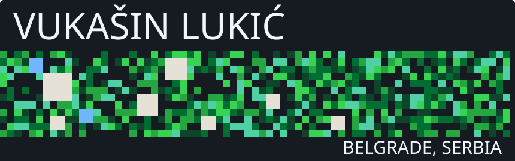
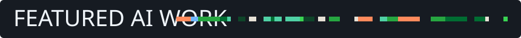
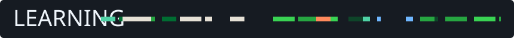

Final-year Software Engineering student at FON Belgrade, building LLM agents and speech features in Python and TypeScript. 
My AI assistant Alano **runs in production** on srpskiusrcu.rs, and my team took 2nd of 83 at UniHack Timișoara 2025. 
Outside code, I DJ and co-organise Novi Talas events in Kruševac (400+ attendees).

  
  

### [VukixAI](https://github.com/VukasinLukic/vukixai-agent.v1)

A command-line coding assistant for developers that runs a local LLM through Ollama, so code never leaves the machine.
With Qwen3.5 9B it passed **24 of 24** runs of my 8-case acceptance suite, including a prompt-injection case and an attempt to read outside the project.
Write and test tools are off by default, and every file path is resolved and checked against the project folder before a tool runs.

`Python` `LangChain` `Ollama` `SQLite FTS5` · [Repository](https://github.com/VukasinLukic/vukixai-agent.v1)

### [Alano](https://srpskiusrcu.rs)

A chat assistant for students of Srpski u Srcu, the Serbian exam-prep platform I built, that answers questions about its courses in Cyrillic.
It is live on srpskiusrcu.rs for signed-in students and visitors.
OpenRouter's free tier allows 50 requests a day for the whole site, so a shared Firestore counter stops at 42 and a chain of 5 free models takes over when one fails.

`Firebase Functions` `OpenRouter` `Firestore` `React` · [Live site](https://srpskiusrcu.rs)

### [Claims forecasting](https://github.com/VukasinLukic/vukasin-lukic-ominimo-application)

A model that predicts how many claims a car insurance policy will have per year, built as a take-home exercise for Ominimo.
On 678K policies, LightGBM cut holdout Poisson deviance by **8.8%** against the baseline, versus 5.2% for a GLM.
Instead of dropping outliers, I measured each suspicious group's share of the deviance and kept every row.

`Python` `scikit-learn` `LightGBM` `pandas` · [Repository](https://github.com/VukasinLukic/vukasin-lukic-ominimo-application)

- **Monax**: a voice expense tracker where Whisper transcribes Serbian speech, an LLM fills a JSON schema and a rule-based parser sets the amount.
- **VukixMCP**: an MCP server that gives Claude seven tools for reading and logging my project notes in Firestore.
- **Velve**: contributed to a swipe-based fashion marketplace app built with Expo.

- **Software Engineer (part-time), AJSA Soft**, Jan 2025 to Jul 2026: backend REST APIs documented with Swagger, and production React and Next.js apps.
- **Co-founder, 4Sports**, May 2024 to May 2026: a platform for sports clubs.
- **2nd of 83 teams, UniHack Timișoara 2025**, as team lead.
- **2nd of 20 teams, FON Hakaton 2025**, as team lead.

<table align="center">
  <tr>
    <td align="center" width="104"> Python</td>
    <td align="center" width="104"> LangChain</td>
    <td align="center" width="104"> Ollama</td>
    <td align="center" width="104"> OpenRouter</td>
    <td align="center" width="104"> scikit-learn</td>
    <td align="center" width="104"> pandas</td>
  </tr>
  <tr>
    <td align="center" width="104"> TypeScript</td>
    <td align="center" width="104"> React</td>
    <td align="center" width="104"> Node.js</td>
    <td align="center" width="104"> Firebase</td>
    <td align="center" width="104"> PostgreSQL</td>
    <td align="center" width="104"> Docker</td>
  </tr>
</table>

PyTorch and Hugging Face Transformers, to fine-tune speech and language models that still handle Serbian badly.

